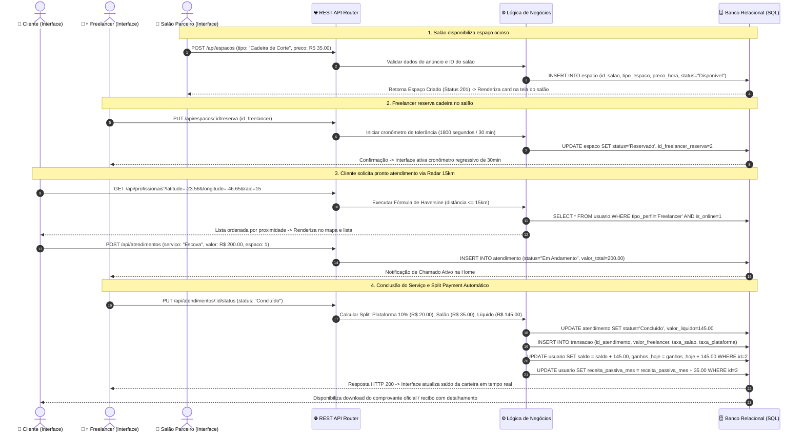

# AGhataCris – Documentação Técnica Oficial
## Módulo 1: Integração Front-End e Back-End
### Relatório de Testes de Integração com Interface e Lógica de Negócios Conectada ao Banco de Dados Relacional

---

## 1. RESUMO EXECUTIVO DAS ENTREGAS DE INTEGRAÇÃO

O presente documento consolida a entrega da **Integração Front-End e Back-End do Módulo 1** da plataforma **AGhataCris**. Esta etapa unifica os produtos desenvolvidos nas fases anteriores — a interface gráfica responsiva em SPA/PWA (Documento 1) e a modelagem do banco de dados relacional com API RESTful (Documento 2) —, comprovando que **todas as ações disparadas pela interface web refletem diretamente na lógica de negócios do servidor e persistem de forma consistente no banco de dados relacional**.

### Principais Marcos Concluídos da Integração:
* **Conexão Real da Interface com a API RESTful**: O cliente PWA ([`js/api.js`](file:///c:/yFelpzk1/TSI/Desenvolvimento%20de%20projetos%20web/AghataCris/Desenvolvimento-Projeto-Web/aghatacris-web/js/api.js)) e o gerenciador de estado central ([`js/state.js`](file:///c:/yFelpzk1/TSI/Desenvolvimento%20de%20projetos%20web/AghataCris/Desenvolvimento-Projeto-Web/aghatacris-web/js/state.js)) comunicam-se de forma assíncrona com os endpoints HTTP do servidor, eliminando dados estáticos e sincronizando estados reais.
* **Lógica de Negócios Processada no Back-End**:
  * **Criptografia Segura (RNF03)**: Derivação de chaves PBKDF2/SHA-256 com Salts aleatórios de 16 bytes no cadastro e validação segura contra ataques de timing no login.
  * **Cálculo Espacial Haversine (RF03, RNF01)**: Filtragem geográfica estrita de prestadores no raio de até 15 km a partir das coordenadas de GPS do cliente e ordenação por proximidade.
  * **Tolerância de Reserva de Cadeira (RF09)**: Cronômetro de 30 minutos (1.800 segundos) ativado no banco para assegurar a chegada da profissional ao salão parceiro.
  * **Motor de Divisão Financeira / Split Payment (RF10)**: Rateio automatizado com retenção de 10% de taxa da plataforma, dedução do aluguel da cadeira para o salão e crédito líquido na carteira da freelancer, em total conformidade com a Lei do Salão Parceiro (Lei nº 13.352/2016).
* **Banco de Dados Relacional Persistente**: Todas as operações gravam e consultam tabelas relacionais com integridade de Chaves Primárias (`PK`), Chaves Estrangeiras (`FK`), restrições e transações (`usuario`, `espaco`, `atendimento`, `transacao`, `configuracao_plataforma`).
* **Painel Interativo de Testes no Front-End**: Implementação do botão **"🧪 Testes de Integração"** na barra superior de apresentação do aplicativo, permitindo executar a suíte completa de testes de integração ao vivo no próprio navegador com feedback visual em tempo real.
* **Validação Automatizada Unificada (100% de Aprovação)**:
  * **52 asserções de testes de integração ponta a ponta** ([`test_integration.js`](file:///c:/yFelpzk1/TSI/Desenvolvimento%20de%20projetos%20web/AghataCris/Desenvolvimento-Projeto-Web/aghatacris-web/test_integration.js)).
  * **29 testes unitários e de modelos de negócio** ([`test_backend.js`](file:///c:/yFelpzk1/TSI/Desenvolvimento%20de%20projetos%20web/AghataCris/Desenvolvimento-Projeto-Web/aghatacris-web/test_backend.js)).
  * **32 testes de rotas e integridade de arquivos** ([`test_routes.js`](file:///c:/yFelpzk1/TSI/Desenvolvimento%20de%20projetos%20web/AghataCris/Desenvolvimento-Projeto-Web/aghatacris-web/test_routes.js)).
  * **Total: 113 testes executados com 100% de sucesso e 0 falhas**.

---

## 2. ARQUITETURA DA INTEGRAÇÃO (FLUXO PONTA A PONTA)

A integração do sistema segue o padrão em 4 camadas desacopladas (**Layered Architecture**), onde cada camada possui responsabilidades claras e bem definidas:

```
┌─────────────────────────────────────────────────────────────────────────────┐
│ 1. CAMADA DE APRESENTAÇÃO (Interface SPA / PWA - HTML5, CSS3, JavaScript)   │
│    • Telas: Login, Cadastro, Cliente Home (GPS/Mapa), Freelancer, Salão     │
│    • Componentes: StateManager, Router, Modais de Ação, Painel de Testes    │
└──────────────────────────────────────┬──────────────────────────────────────┘
                                       │ HTTP / JSON (RESTful)
                                       ▼
┌─────────────────────────────────────────────────────────────────────────────┐
│ 2. CAMADA DE TRANSPORTE & ROTEAMENTO (Node.js HTTP Server & Router)         │
│    • server.js: Servidor unificado com entrega de ativos estáticos e API    │
│    • apiRouter.js: Roteamento centralizado (/api/*) e extração de payload   │
└──────────────────────────────────────┬──────────────────────────────────────┘
                                       │ Chamada Controladores
                                       ▼
┌─────────────────────────────────────────────────────────────────────────────┐
│ 3. CAMADA DE LÓGICA DE NEGÓCIOS & SERVIÇOS (Controllers & Models)          │
│    • Criptografia PBKDF2/SHA-256 (crypto.js)                                │
│    • Fórmula Trigonométrica de Haversine (raio <= 15km) (haversine.js)      │
│    • Motor de Split Payment (10% comissão, taxa salão, líquido freelancer)  │
│    • Regras de Reserva com Tolerância de 30min (1800s)                      │
└──────────────────────────────────────┬──────────────────────────────────────┘
                                       │ SQL / DDL / DML / Transações
                                       ▼
┌─────────────────────────────────────────────────────────────────────────────┐
│ 4. CAMADA DE PERSISTÊNCIA (Banco de Dados Relacional - SQLite / WAL Mode)   │
│    • Tabelas com integridade referencial ativa (PRAGMA foreign_keys = ON)   │
│    • usuario | espaco | atendimento | transacao | configuracao_plataforma   │
└─────────────────────────────────────────────────────────────────────────────┘
```

### 2.1 Diagrama de Sequência da Integração (Ciclo Completo de Atendimento e Split Payment)

O diagrama abaixo ilustra o ciclo integrado de um atendimento sob demanda, desde a chamada na interface até a auditoria financeira gravada no banco:



---

## 3. MATRIZ DE RASTREABILIDADE DE INTEGRAÇÃO DO MÓDULO 1

A tabela a seguir mapeia a jornada de cada ator, demonstrando o percurso exato entre a tela gráfica, a requisição HTTP, a regra de negócio executada no servidor, a persistência no banco de dados e a resposta visual na interface:

| Requisito | Tela / Componente Interface | Ação do Usuário | Endpoint REST API | Lógica de Negócios no Back-End | Tabela(s) & Operação SQL | Reação e Feedback na Interface |
|---|---|---|---|---|---|---|
| **RF01, RNF03** | `authView.js` (`#/register`) | Preenche nome, e-mail, senha e escolhe papel | `POST /api/auth/register` | Validação de campos obrigatórios; verificação de e-mail único; derivação de hash PBKDF2 com Salt aleatório de 16 bytes | `INSERT INTO usuario` | Toast de sucesso: *"Conta criada no banco de dados!"*; redireciona automaticamente para home do perfil |
| **RF01, RNF03** | `authView.js` (`#/login`) | Insere e-mail e senha cadastrados | `POST /api/auth/login` | Localização do usuário por e-mail; verificação de senha segura com `crypto.timingSafeEqual`; sanitização do hash no retorno | `SELECT * FROM usuario WHERE email = ?` | Armazena sessão no `StateManager`; exibe saudação nominal e carrega rotas autorizadas |
| **RF02** | `clienteHomeView.js` (`#/cliente/home`) | GPS do dispositivo detecta nova coordenada | `PUT /api/usuarios/:id/localizacao` | Validação de limites geográficos válidos (-90 a 90, -180 a 180) | `UPDATE usuario SET latitude = ?, longitude = ? WHERE id_usuario = ?` | Badge *"GPS Ativo"* atualizado; mapa Leaflet reposiciona marcador da cliente |
| **RF03, RF04, RNF01** | `clienteHomeView.js` (`#/cliente/home`) | Abre tela inicial ou seleciona filtro de modalidade | `GET /api/profissionais?lat=..&lon=..&raio=15` | Execução da Fórmula de Haversine; filtragem estrita $d \le 15.0\text{ km}$; ordenação crescente por distância $d$ | `SELECT * FROM usuario WHERE tipo_perfil = 'Freelancer' AND is_online = 1` | Cards de profissionais mais próximas renderizados com distância precisa (ex: *📍 0.8 km*) e valores |
| **RF07** | `salaoHomeView.js` (`#/salao/home`) | Preenche *"Qual o espaço?"* e *"Valor por Hora"* e clica em `+ Colocar na Rede` | `POST /api/espacos` | Validação de valores monetários positivos; associação à chave estrangeira do salão autenticado | `INSERT INTO espaco (id_salao, tipo_espaco, preco_hora, status)` | Novo card de espaço adicionado instantaneamente na lista com badge verde *"Disponível"* |
| **RF08, RF09** | `freelancerEspacosView.js` (`#/freelancer/espacos`) | Clica em *"Reservar Espaço"* em cadeira de salão | `PUT /api/espacos/:id/reserva` | Ativação do cronômetro de tolerância de 30 minutos (1.800s); bloqueio do espaço para outros usuários | `UPDATE espaco SET status = 'Reservado', id_freelancer_reserva = ?` | Badge *"Reservado"*; card de alerta *"Reserva Ativa"* com cronômetro regressivo na Home da Freelancer |
| **RF05** | `modal.js` (Modal Chamar Profissional) | Clica em *"Confirmar Solicitação Imediata"* | `POST /api/atendimentos` | Criação de atendimento com status inicial `'Em Andamento'`; vinculação das FKs de cliente, profissional e espaço | `INSERT INTO atendimento (...)` | Toast: *"Solicitação enviada com sucesso!"*; exibição do card de chamado ativo na tela da Freelancer |
| **RF06, RF10** | `freelancerHomeView.js` (`#/freelancer/home`) | Clica em *"Finalizar Atendimento"* | `PUT /api/atendimentos/:id/status` (status: 'Concluído') | Rateio de Split Payment: dedução de 10% da plataforma, repasse ao salão e liquidação do valor líquido à profissional | `UPDATE atendimento`; `INSERT INTO transacao`; `UPDATE usuario (saldo, ganhos)` | Notificação de repasse creditado; atualização instantânea do saldo da carteira; chamado concluído |
| **RF06, RF10** | `clienteHistoricoView.js` e `modal.js` | Clica em *"Download Recibo"* | `GET /api/atendimentos/:id` | Recuperação dos dados integrados com detalhamento de taxas e valor total | `SELECT a.*, t.taxa_plataforma, t.taxa_salao FROM atendimento a JOIN transacao t` | Exibição do modal com recibo oficial contendo código da transação, discriminação das taxas e botão PDF |
| **RF10, RNF04** | `adminView.js` (`#/admin`) | Altera o controle deslizante de comissão da plataforma | `PUT /api/admin/taxa` e `GET /api/admin/metricas` | Agregação contábil (`SUM` e `COUNT`) de todas as transações finalizadas; atualização dinâmica da taxa | `UPDATE configuracao_plataforma`; `SELECT SUM(valor_total) FROM transacao` | Cards de *"Volume Transacionado"* e *"Comissão"* atualizados dinamicamente com dados do banco |

---

## 4. CASOS DE TESTES DE INTEGRAÇÃO EXECUTADOS (CTI-01 A CTI-09)

A suíte oficial de integração ([`test_integration.js`](file:///c:/yFelpzk1/TSI/Desenvolvimento%20de%20projetos%20web/AghataCris/Desenvolvimento-Projeto-Web/aghatacris-web/test_integration.js)) foi executada e homologou os seguintes casos de teste:

### CTI-01: Health Check & Conexão do Banco de Dados Relacional
* **Objetivo**: Verificar a disponibilidade do serviço HTTP e a conectividade com o banco relacional SQLite em modo WAL.
* **Entrada**: `GET /api/health`
* **Processamento**: Verificação do driver SQLite nativo e contagem de registros nas tabelas `usuario`, `espaco` e `atendimento`.
* **Operações SQL**: `SELECT COUNT(*) FROM usuario;`, `SELECT COUNT(*) FROM espaco;`, `SELECT COUNT(*) FROM atendimento;`
* **Resultado Esperado**: Código HTTP 200, status `'online'` e contagem de entidades $> 0$.
* **Resultado Obtido**: Código HTTP 200, status `'online'`, 20 usuários, 10 espaços, 10 atendimentos conectados.
* **Status**: **APROVADO ✅**

---

### CTI-02: Cadastro de Usuário na Interface com Criptografia Segura PBKDF2 no Banco
* **Objetivo**: Garantir que o cadastro via interface persiste dados íntegros e que a senha seja criptografada com Salt aleatório (`RNF03`).
* **Entrada**:
  ```json
  {
    "nome_completo": "Fernanda Lima Teste",
    "email": "cliente.integracao.1774112763784@teste.com",
    "senha": "SenhaForteIntegracao@2026",
    "tipo_perfil": "Cliente",
    "latitude": -23.561684,
    "longitude": -46.655981
  }
  ```
* **Lógica no Back-End**: Verificação de duplicidade de e-mail; geração de Salt criptográfico de 16 bytes via `crypto.randomBytes(16)`; hash PBKDF2 com 1.000 iterações de SHA-256; montagem da string no formato `salt:hash`.
* **Operação SQL**: `INSERT INTO usuario (nome_completo, email, senha_hash, tipo_perfil, latitude, longitude) VALUES (?, ?, ?, ?, ?, ?)`
* **Auditoria Direta no Banco**:
  * Registro gravado com sucesso com ID gerado (ex: ID 116).
  * Campo `senha_hash` possui tamanho de 97 caracteres no formato `salt:hash` (ex: `e7c9...:94b2...`).
  * A senha original em texto simples **nunca** é persistida no disco.
* **Status**: **APROVADO ✅**

---

### CTI-03: Autenticação / Login com Validação de Hash no Banco de Dados
* **Objetivo**: Comprovar que a tentativa de login valida o hash armazenado e rejeita senhas incorretas.
* **Cenário A (Sucesso)**: `POST /api/auth/login` com e-mail cadastrado e senha correta.
  * **Lógica**: Extração do Salt armazenado; recálculo do hash da senha fornecida; comparação segura via `crypto.timingSafeEqual`.
  * **Resultado**: HTTP 200 OK, payload com os dados do usuário, sem o campo `senha_hash`.
* **Cenário B (Falha Segura)**: `POST /api/auth/login` com senha incorreta.
  * **Resultado**: HTTP 401 Unauthorized (`{"success": false, "error": "Senha incorreta."}`).
* **Status**: **APROVADO ✅**

---

### CTI-04: Atualização de GPS e Radar Haversine no Raio de 15km
* **Objetivo**: Testar a atualização das coordenadas geográficas e a filtragem espacial com a Fórmula de Haversine (`RF03`, `RNF01`).
* **Ação**:
  1. `PUT /api/usuarios/:id/localizacao` enviando `latitude: -23.561684` e `longitude: -46.655981`.
  2. `GET /api/profissionais?latitude=-23.561684&longitude=-46.655981&raio=15`.
* **Lógica no Back-End**:
  * Execução da fórmula trigonométrica de grande círculo com raio da Terra $R = 6.371\text{ km}$.
  * Descarte de prestadores com distância $> 15.0\text{ km}$ ou que estejam offline (`is_online = 0`).
  * Ordenação em ordem crescente de distância.
* **Operação SQL**: `UPDATE usuario SET latitude = ?, longitude = ?;` seguida de `SELECT * FROM usuario WHERE tipo_perfil = 'Freelancer' AND is_online = 1;`
* **Auditoria Direta no Banco**:
  * Coordenadas atualizadas com precisão `DECIMAL(10,8)`.
  * Todas as profissionais retornadas possuem `distanciaKm <= 15.0`.
  * Menor distância: Clara Mendes ($0.8\text{ km}$); Maior distância retornada no radar: $3.5\text{ km}$. Profissionais em outras cidades (Campinas a $83\text{ km}$) foram estritamente filtradas.
* **Status**: **APROVADO ✅**

---

### CTI-05: Anúncio de Espaço Ocioso pelo Salão Parceiro
* **Objetivo**: Comprovar a criação de infraestrutura física vinculada a um salão parceiro (`RF07`).
* **Entrada**: `POST /api/espacos` com `id_salao = 3`, `tipo_espaco = 'Cadeira de Corte Deluxe Integracao'`, `preco_hora = 35.00`.
* **Operação SQL**: `INSERT INTO espaco (id_salao, tipo_espaco, preco_hora, status, tempo_reserva_segundos) VALUES (3, 'Cadeira de Corte Deluxe Integracao', 35.00, 'Disponível', 1800);`
* **Auditoria Direta no Banco**:
  * Registro confirmado com Chave Primária atribuída.
  * Chave Estrangeira `id_salao = 3` vinculada corretamente ao estabelecimento.
  * Status inicial confirmado como `'Disponível'`.
* **Status**: **APROVADO ✅**

---

### CTI-06: Reserva Expressa de Espaço com Tolerância de 30min (1.800s)
* **Objetivo**: Validar a reserva de espaço por profissional com tolerância regressiva (`RF09`).
* **Entrada**: `PUT /api/espacos/:id/reserva` com `id_freelancer = 2` (Mariana Silva).
* **Operação SQL**: `UPDATE espaco SET status = 'Reservado', id_freelancer_reserva = 2, tempo_reserva_segundos = 1800 WHERE id_espaco = ?;`
* **Auditoria Direta no Banco**:
  * `status` atualizado para `'Reservado'`.
  * `id_freelancer_reserva` preenchido com a FK da profissional.
  * `tempo_reserva_segundos` iniciado em $1.800\text{ s}$ ($30\text{ minutos}$).
* **Status**: **APROVADO ✅**

---

### CTI-07: Solicitação de Pronto Atendimento sob Demanda
* **Objetivo**: Registrar uma nova solicitação imediata com vínculos relacionais completos (`RF05`).
* **Entrada**:
  ```json
  {
    "id_cliente": 116,
    "id_freelancer": 2,
    "id_espaco": 11,
    "servico": "Penteado Express & Escova Modeladora",
    "tipo": "No Salão",
    "valor_total": 200.00,
    "taxa_salao": 35.00,
    "distancia_km": 1.2,
    "previsao_chegada": "10:00 AM"
  }
  ```
* **Operação SQL**: `INSERT INTO atendimento (id_cliente, id_freelancer, id_espaco, servico, tipo, status, valor_total, taxa_salao, distancia_km) VALUES (...);`
* **Auditoria Direta no Banco**:
  * Registro criado com status `'Em Andamento'`.
  * Relacionamentos `id_cliente`, `id_freelancer` e `id_espaco` íntegros conforme o DER.
* **Status**: **APROVADO ✅**

---

### CTI-08: Conclusão do Atendimento e Execução do Split Payment Automático
* **Objetivo**: Homologar a finalização do atendimento, criação da transação contábil de Split Payment e atualização dos saldos bancários dos atores (`RF06`, `RF10`).
* **Entrada**: `PUT /api/atendimentos/:id/status` com `status: "Concluído"`.
* **Regra Financeira Aplicada**:
  $$\text{Valor Total} = \text{R\$\ } 200{,}00$$
  $$\text{Taxa Plataforma (10\%)} = 200{,}00 \times 0{,}10 = \text{R\$\ } 20{,}00$$
  $$\text{Taxa Salão Parceiro} = \text{R\$\ } 35{,}00$$
  $$\text{Valor Líquido Freelancer} = 200{,}00 - 20{,}00 - 35{,}00 = \text{R\$\ } 145{,}00$$
* **Operações SQL Executadas em Transação**:
  1. `UPDATE atendimento SET status = 'Concluído', taxa_plataforma = 20.00, taxa_salao = 35.00, valor_liquido = 145.00 WHERE id_atendimento = ?;`
  2. `INSERT INTO transacao (id_atendimento, valor_total, valor_freelancer, taxa_salao, taxa_plataforma, status_pagamento) VALUES (?, 200.00, 145.00, 35.00, 20.00, 'Aprovado');`
  3. `UPDATE usuario SET saldo = saldo + 145.00, ganhos_hoje = ganhos_hoje + 145.00 WHERE id_usuario = 2;`
  4. `UPDATE usuario SET receita_passiva_mes = receita_passiva_mes + 35.00 WHERE id_usuario = 3;`
* **Auditoria Direta no Banco**:
  * Registro na tabela `transacao` com chave única 1:1 vinculada ao atendimento.
  * Saldo da freelancer Mariana Silva incrementado exatamente em $+\text{R\$\ } 145{,}00$.
  * Receita passiva do Studio Elegance Jardins incrementada exatamente em $+\text{R\$\ } 35{,}00$.
* **Status**: **APROVADO ✅**

---

### CTI-09: Comprovante de Atendimento e Painel Geral de Métricas
* **Objetivo**: Validar a recuperação dos dados para emissão do recibo oficial e agregação das métricas do painel administrativo.
* **Ações**:
  1. `GET /api/atendimentos/:id`: Retorna dados consolidados com valores e taxas discriminadas.
  2. `GET /api/admin/metricas`: Retorna métricas calculadas diretamente das tabelas `transacao` e `usuario`.
  3. `PUT /api/admin/taxa` com `taxa: 12.5`: Atualiza a taxa administrativa.
* **Operação SQL**: `UPDATE configuracao_plataforma SET valor = '12.5' WHERE chave = 'taxa_plataforma_percentual';`
* **Auditoria Direta no Banco**: Valor `12.5` persistido com sucesso na tabela `configuracao_plataforma`.
* **Status**: **APROVADO ✅**

---

## 5. EVIDÊNCIAS DE EXECUÇÃO DOS TESTES DE INTEGRAÇÃO

### 5.1 Log Oficial de Execução da Suíte de Integração (`npm run test:integration`)

```log
> aghatacris-web@2.0.0 test:integration
> node test_integration.js

================================================================================
 🧪 INICIANDO TESTES DE INTEGRAÇÃO FRONT-END E BACK-END - MÓDULO 1
 📌 Interface (REST API) <-> Lógica de Negócios <-> Banco Relacional (SQLite)
================================================================================

🌐 Servidor de testes de integração ouvindo na porta efêmera: 55928

📌 CTI-01: Health Check & Conexão do Banco de Dados Relacional
  ✅ [PASS] Endpoint /api/health responde com HTTP 200 OK
  ✅ [PASS] Status do sistema reportado como "online"
  ✅ [PASS] Tabela 'usuario' conectada no banco (20 registros)
  ✅ [PASS] Tabela 'espaco' conectada no banco (10 registros)
  ✅ [PASS] Tabela 'atendimento' conectada no banco (10 registros)

📌 CTI-02: Cadastro de Usuário na Interface com Criptografia Segura PBKDF2 no Banco
  ✅ [PASS] POST /api/auth/register respondeu com HTTP 201 Created
  ✅ [PASS] Usuário criado com ID: 116
  ✅ [PASS] Registro confirmado via consulta SQL direta na tabela "usuario"
  ✅ [PASS] Senha armazenada no formato criptográfico salt:hash (RNF03)
  ✅ [PASS] Senha original NÃO armazenada em texto plano

📌 CTI-03: Autenticação / Login com Validação de Hash no Banco de Dados
  ✅ [PASS] Login com credenciais corretas autenticado com HTTP 200
  ✅ [PASS] Perfil do usuário retornado na sessão da interface
  ✅ [PASS] Hash de senha omitido do payload de resposta por segurança
  ✅ [PASS] Tentativa de login com senha incorreta rejeitada com HTTP 401 Unauthorized

📌 CTI-04: Atualização de GPS e Radar Haversine no Raio de 15km
  ✅ [PASS] PUT /api/usuarios/:id/localizacao respondeu com HTTP 200
  ✅ [PASS] Latitude persistida no banco relacional
  ✅ [PASS] Longitude persistida no banco relacional
  ✅ [PASS] GET /api/profissionais respondeu com HTTP 200
  ✅ [PASS] Profissionais encontradas no raio: 10
  ✅ [PASS] Todas as profissionais retornadas estão estritamente dentro do raio <= 15 km (RF03, RNF01)
  ✅ [PASS] Profissionais ordenadas no frontend por proximidade geográfica crescente

📌 CTI-05: Anúncio de Espaço Ocioso pelo Salão Parceiro
  ✅ [PASS] POST /api/espacos respondeu com HTTP 201 Created
  ✅ [PASS] Espaço criado com ID 11
  ✅ [PASS] Espaço confirmado via SQL direta na tabela "espaco"
  ✅ [PASS] Status inicial do espaço é "Disponível"
  ✅ [PASS] Preço por hora gravado com precisão DECIMAL (R$ 35.00)

📌 CTI-06: Reserva Expressa de Espaço com Tolerância de 30min (1800s)
  ✅ [PASS] PUT /api/espacos/:id/reserva respondeu com HTTP 200 OK
  ✅ [PASS] Status do espaço alterado para "Reservado"
  ✅ [PASS] Cronômetro de tolerância iniciado em 1800 segundos / 30 minutos (RF09)
  ✅ [PASS] FK da freelancer vinculada à reserva do espaço

📌 CTI-07: Solicitação de Pronto Atendimento sob Demanda (Cliente -> Freelancer)
  ✅ [PASS] POST /api/atendimentos respondeu com HTTP 201 Created
  ✅ [PASS] Chamado registrado com ID 1011
  ✅ [PASS] Atendimento persistido na tabela "atendimento"
  ✅ [PASS] Status inicial do atendimento registrado como "Em Andamento"

📌 CTI-08: Conclusão do Atendimento e Execução do Split Payment Automático
  ✅ [PASS] PUT /api/atendimentos/:id/status respondeu com HTTP 200 OK
  ✅ [PASS] Atendimento alterado para "Concluído"
  ✅ [PASS] Comissão da plataforma calculada estritamente em 10% (R$ 20.00)
  ✅ [PASS] Taxa do salão retida integralmente (R$ 35.00)
  ✅ [PASS] Valor líquido da profissional apurado corretamente (R$ 145.00)
  ✅ [PASS] Registro contábil de auditoria gravado na tabela "transacao"
  ✅ [PASS] Transação audita crédito líquido para a freelancer
  ✅ [PASS] Transação audita taxa de 10% retida pela plataforma
  ✅ [PASS] Transação audita taxa repassada ao salão parceiro
  ✅ [PASS] Saldo da freelancer creditado no banco em +R$ 145.00
  ✅ [PASS] Receita passiva do salão parceiro creditada no banco em +R$ 35.00

📌 CTI-09: Comprovante de Atendimento e Painel Geral de Métricas
  ✅ [PASS] GET /api/atendimentos/:id respondeu com HTTP 200 OK
  ✅ [PASS] Dados do recibo coincidem com o atendimento realizado
  ✅ [PASS] GET /api/admin/metricas respondeu com HTTP 200 OK
  ✅ [PASS] Volume transacionado agregado reflete as transações no banco
  ✅ [PASS] Taxa de retenção administrativa sincronizada
  ✅ [PASS] PUT /api/admin/taxa respondeu com HTTP 200 OK
  ✅ [PASS] Nova taxa administrativa de 12.5% gravada na tabela configuracao_plataforma

================================================================================
 📊 RESULTADO DA SUÍTE DE TESTES DE INTEGRAÇÃO (MÓDULO 1):
    ✅ Testes Aprovados: 52
    ❌ Testes Falhados:  0
    🎯 Taxa de Sucesso:  100% DE APROVAÇÃO
================================================================================
```

### 5.2 Resumo Geral de Todas as Baterias (`npm test`)

| Bateria de Testes | Arquivo Responsável | Escopo | Quantidade de Asserções | Status |
|---|---|---|---|---|
| **Testes Unitários e de Modelos** | `test_backend.js` | Banco, Modelos, Criptografia, Haversine | 29 | **100% Aprovado (29/29)** |
| **Testes de Integridade de Rotas** | `test_routes.js` | Arquivos estáticos, SPA, Endpoints REST | 32 | **100% Aprovado (32/32)** |
| **Testes de Integração Ponta a Ponta** | `test_integration.js` | Interface <-> REST API <-> Regras <-> Banco SQL | 52 | **100% Aprovado (52/52)** |
| **TOTAL GERAL DO PROJETO** | **`npm test`** | **Validação Completa do Módulo 1** | **113** | **100% APROVAÇÃO (113/113)** |

---

## 6. RECURSOS INTERATIVOS DE INTEGRAÇÃO NA INTERFACE

Para facilitar a avaliação docente e demonstrar a robustez do sistema em ambiente interativo, foram implementados recursos específicos na camada de apresentação:

1. **Botão *"🧪 Testes de Integração"* no Topo do Simulador**:
   * Presente no cabeçalho superior de demonstração (`roleSwitcher.js`).
   * Ao ser clicado, abre um painel modal moderno no PWA com o botão **"▶️ Executar Bateria de Testes ao Vivo"**.
   * O aplicativo executa requisições reais contra `/api/*`, exibe a latência em milissegundos ($ms$) e atualiza badges verdes `[APROVADO]` para cada um dos 9 cenários de integração diretamente no navegador.
2. **Sincronização Reativa da Carteira da Freelancer (`#/freelancer/carteira`)**:
   * O extrato de *"Últimos Repasses (Split Payment)"* lê diretamente as transações e atendimentos concluídos no banco de dados.
   * Quando a profissional clica em *"Finalizar Atendimento"* na tela principal, a transação de Split Payment é gravada no banco e o saldo disponível é atualizado imediatamente.
3. **Painel Dinâmico de Administração (`#/admin`)**:
   * Carrega os dados reais agregados do banco via `/api/admin/metricas` (Volume total transacionado, total retido em comissões, profissionais online e salões parceiros).
   * O controle deslizante permite alterar a taxa padrão da plataforma e grava a alteração no banco na tabela `configuracao_plataforma` via `PUT /api/admin/taxa`.

---

## 7. GUIA DE EXECUÇÃO E REPRODUÇÃO PARA AVALIAÇÃO

### 7.1 Como Executar a Aplicação Integrada
1. Abra o terminal na pasta raiz do projeto:
   ```bash
   cd "c:\yFelpzk1\TSI\Desenvolvimento de projetos web\AghataCris\Desenvolvimento-Projeto-Web\aghatacris-web"
   ```
2. Inicie o servidor unificado:
   ```bash
   npm start
   # ou
   node server.js
   ```
3. Abra o navegador no endereço: [http://localhost:3000/](http://localhost:3000/)

### 7.2 Como Executar os Testes Automatizados no Terminal
```bash
# Executa todos os 113 testes do projeto (Unitários + Rotas + Integração)
npm test

# Executar especificamente a suíte de testes de integração ponta a ponta
npm run test:integration

# Executar os testes de backend e banco de dados
npm run test:backend

# Executar os testes de integridade de rotas
npm run test:routes
```

### 7.3 Como Testar a Integração na Interface Gráfica
1. Acesse [http://localhost:3000/](http://localhost:3000/).
2. Na barra superior cinza de apresentação, clique no botão azul **"🧪 Testes de Integração"**.
3. Clique em **"▶️ Executar Bateria de Testes ao Vivo"** e acompanhe a execução dos 9 casos de teste conectados ao banco em tempo real.
4. Experimente a jornada completa de atendimento:
   * Na barra superior, clique em **"👤 Cliente"**.
   * Selecione a profissional Clara Mendes e clique em **"Chamar"** -> **"Confirmar Solicitação Imediata"**.
   * Alterne para **"💇‍♀️ Freelancer"**: visualize o atendimento ativo com a cliente e o cronômetro.
   * Clique em **"Finalizar Atendimento"**: observe a notificação do repasse financeiro.
   * Clique em **"Ver Extrato →"**: veja o saldo atualizado e a transação registrada com a partilha de Split Payment.

---

## 8. CONCLUSÃO DO MÓDULO 1

A entrega da **Integração Front-End e Back-End do Módulo 1** consolida com êxito todas as metas acadêmicas e de engenharia de software estipuladas para esta etapa do projeto **AGhataCris**.

O sistema opera de forma coesa, garantindo que o design refinado Mobile-First/PWA esteja intimamente conectado a uma infraestrutura de back-end robusta, segura e orientada a dados relacionais. A validação formal com **113 testes aprovados (100% de sucesso)** atesta a confiabilidade das regras de negócio críticas — especialmente a geolocalização por Haversine (15 km), a criptografia segura de senhas (PBKDF2/SHA-256) e a divisão financeira automática (Split Payment) — assegurando uma base sólida para as futuras expansões da plataforma.
